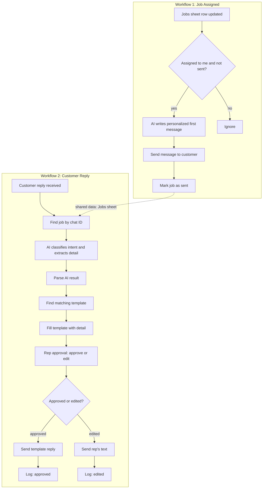

# AI Job Assistant: Automated Customer Messaging with Human Approval

> An n8n automation that messages customers when a field-service job is assigned, then uses AI to understand their replies and **suggest** an answer from pre-approved templates. A human approves or edits every reply before it is sent.


**Demo video:** https://youtu.be/-1m4DlNJPGY

---

## Table of contents

1. [The problem](#the-problem)
2. [The solution](#the-solution)
3. [Architecture](#architecture)
4. [Tech stack](#tech-stack)
5. [How it works](#how-it-works)
6. [Key design decisions](#key-design-decisions)
7. [Data model](#data-model)
8. [Screenshots](#screenshots)
9. [Setup guide](#setup-guide)
10. [Testing](#testing)
11. [Limitations and next steps](#limitations-and-next-steps)
12. [Moving to the production stack](#moving-to-the-production-stack)
13. [Repository structure](#repository-structure)

---

## The problem

Field-service companies (plumbing, HVAC, locksmiths and similar) lose time on repetitive customer texting:

- When a technician is assigned to a job, someone must manually text the customer.
- Customers reply in free text ("can we do Friday?", "how much will it cost?", "cancel it"), and every reply needs reading, understanding, and answering.
- Fully automatic AI replies are risky. A wrong answer sent to a customer damages trust.

## The solution

Two connected n8n workflows:

1. **Job assigned:** when a job is assigned to a technician, the customer automatically receives a short, personalized message asking them to confirm.
2. **Customer reply:** when the customer answers, AI classifies the intent and picks the matching **pre-approved template**. The suggestion is sent to a human representative, who **approves it or edits it**. Only then is the reply sent to the customer.

**The AI never writes the final reply on its own.** It only chooses a category and extracts one detail (such as the requested day). The wording comes from templates the company controls.

## Architecture



The two workflows do not call each other. **Google Sheets is the shared source of truth**, so if one workflow breaks the other keeps working.

## Tech stack

This project was built with free tools. Each one maps to a production tool from the original use case, so it can be swapped by changing a single node.

| Layer | Used here | Production equivalent | Role |
|---|---|---|---|
| Automation | n8n (self-hosted, Docker) | Make / n8n | Orchestrates both workflows |
| Job system | Google Sheets | Workiz | Jobs, templates, and logs |
| Messaging | Telegram Bot API | Quo / OpenPhone SMS | Two-way customer messaging |
| AI | Google Gemini API (free tier) | OpenAI | Message writing and intent classification |
| Human approval | n8n "Send and wait for response" | Same | Rep approves or edits |
| Public webhook | ngrok | Hosted n8n with a public URL | Lets Telegram reach local n8n |

## How it works

### Workflow 1: Job Assigned → Send First Message

| Step | Node | What it does |
|---|---|---|
| 1 | Job row updated | Google Sheets trigger, polls every minute |
| 2 | Assigned to me and not sent? | IF filter: `assigned_to` matches AND `message_sent` is empty. Prevents duplicate messages |
| 3 | Write first message | Gemini writes a short, personalized message from the job data |
| 4 | Send first message | Telegram message to the customer |
| 5 | Mark as sent | Sets `message_sent = yes` on the row |

### Workflow 2: Customer Reply → AI Suggestion → Rep Approval

| Step | Node | What it does |
|---|---|---|
| 1 | Customer reply received | Telegram trigger (webhook) |
| 2 | Find job | Looks up the job by the customer's chat ID |
| 3 | Classify intent | Gemini returns JSON: `{"intent": "...", "detail": "..."}` |
| 4 | Parse AI result | Code node cleans and parses the JSON |
| 5 | Find template | Looks up the template for that intent in the Templates sheet |
| 6 | Fill template | Inserts the detail (for example "Friday") into the template |
| 7 | Rep approval | Sends the customer message and suggestion to the rep, then waits |
| 8 | Approved or edited? | Rep types `ok` to approve, or types their own text to override |
| 9 | Send approved / edited reply | Sends the final message to the customer |
| 10 | Log approved / Log edited | Appends a row to the Logs sheet |

### Supported intents

| Intent | Example customer message | Template |
|---|---|---|
| `confirm` | "Yes, see you then" | Great, see you at the scheduled time! |
| `reschedule_with_time` | "Can we do Friday?" | Thanks! We'll check our availability for {{detail}} and confirm shortly. |
| `reschedule_no_time` | "Can we change the date?" | No problem, what day works better for you? |
| `question` | "How much will it cost?" | Thanks for asking, a team member will reply shortly. |
| `cancel` | "Cancel it" | Understood, your job has been cancelled. |
| `other` | "Hello" | Thanks for your message, a team member will get back to you. |

## Key design decisions

1. **AI suggests, humans decide.** Nothing reaches the customer without approval. This follows the client's requirement and is how AI should be deployed where mistakes are costly.
2. **The AI only classifies.** Replies come from templates, so tone, pricing, and promises stay under company control and are easy to audit.
3. **Templates live in a sheet, not in the prompt.** A non-technical person can edit replies without touching the workflow.
4. **Split the reschedule intent in two.** The first version asked "What day works?" even when the customer already said "Friday". Separate intents plus a detail field fixed this.
5. **A fallback intent (`other`).** Unclear messages get a safe answer instead of a forced guess.
6. **Duplicate protection.** The IF filter and the `message_sent` flag stop the trigger from sending twice when a row is edited again.
7. **One workflow per event.** "Job assigned" and "customer replied" are different events, so they are separate workflows linked through the sheet.
8. **Approve or edit.** The rep can send the suggestion unchanged or replace it with their own wording.
9. **Everything is logged.** Each handled message records the customer text, the intent, what was sent, and whether it was approved or edited.
10. **Retries on AI calls.** Gemini can return temporary "service unavailable" errors, so the AI nodes use Retry On Fail.

## Data model

**Jobs** (one row per job)

| Column | Description |
|---|---|
| `job_id` | Unique job ID |
| `customer_name` | Customer or company name |
| `telegram_chat_id` | Customer's chat ID (stands in for a phone number) |
| `job_type` | For example "Water heater repair" |
| `scheduled_time` | Appointment date and time |
| `address` | Job address |
| `assigned_to` | Technician the job is assigned to |
| `message_sent` | `yes` once the first message went out |

**Templates**

| Column | Description |
|---|---|
| `intent` | Lowercase intent name |
| `template_text` | Pre-approved reply, may contain `{{detail}}` |

**Logs**

| Column | Description |
|---|---|
| `timestamp` | When the reply was handled |
| `customer_name` | Customer |
| `customer_message` | What the customer wrote |
| `intent` | Detected intent |
| `detail` | Extracted detail (day or time) |
| `suggested_reply` | Text actually sent |
| `approved` | `yes` (template approved) or `edited` (rep rewrote it) |

Sample templates are in [`sample-data/templates.csv`](sample-data/templates.csv).

## Screenshots

| Workflow 1 | Workflow 2 |
|---|---|
|  |  |


## Setup guide

### Prerequisites

- Docker Desktop
- A Google account (Sheets, Google Cloud project, Gemini API key)
- A Telegram account
- A free ngrok account

### 1. Create the Google Sheet

Create one spreadsheet with three tabs: `Jobs`, `Templates`, `Logs`, using the columns from the [data model](#data-model). Import `sample-data/templates.csv` into `Templates`.

### 2. Create the Telegram bot

1. Message **@BotFather** on Telegram and send `/newbot`.
2. Save the bot token (keep it private).
3. Open your bot and press **Start**, then get your chat ID from `https://api.telegram.org/bot<TOKEN>/getUpdates`.

### 3. Get a Gemini API key

Create a key in Google AI Studio. Check the current free-tier limits there, since they change.

### 4. Set up Google OAuth for n8n

1. In Google Cloud Console, create a project and enable the **Google Sheets API** and **Google Drive API**.
2. Configure the OAuth consent screen (External) and add your Gmail as a test user.
3. Create an **OAuth client ID** (Web application) with this redirect URI:
   `http://localhost:5678/rest/oauth2-credential/callback`
4. Keep the Client ID and Client Secret for n8n.

### 5. Expose n8n with ngrok

Telegram needs a public HTTPS URL to deliver customer messages to n8n.

```bash
ngrok config add-authtoken YOUR_NGROK_TOKEN
ngrok http 5678
```

Copy the `https://...ngrok-free.app` URL.

### 6. Run n8n with Docker

```bash
docker volume create n8n_data

docker run -it --rm --name n8n -p 5678:5678 \
  -e WEBHOOK_URL=https://YOUR-NGROK-URL/ \
  -v n8n_data:/home/node/.n8n \
  docker.n8n.io/n8nio/n8n
```

Open n8n at `http://localhost:5678` (not the ngrok URL, because the Google login is tied to localhost). If ngrok gives you a new URL after a restart, restart n8n with the new `WEBHOOK_URL`.

### 7. Import and configure the workflows

1. In n8n, import both files from `workflows/` (menu → Import from file).
2. Create credentials: **Google Sheets OAuth2**, **Telegram**, **Google Gemini (PaLM)**.
3. In each node, select your own spreadsheet and replace the sample technician name and chat IDs.
4. Publish both workflows.

## Testing

| Test | Expected result |
|---|---|
| Put your name in `assigned_to` on a job | Customer gets a personalized message, `message_sent` becomes `yes` |
| Edit the same row again | No second message (IF filter blocks it) |
| Reply "yes see you then" | Intent `confirm`, rep sees the confirm template |
| Reply "can we do Friday?" | Intent `reschedule_with_time`, suggestion mentions "Friday" |
| Reply "can we change the date?" | Intent `reschedule_no_time` |
| Reply "how much will it cost?" | Intent `question` |
| Reply "hello" | Intent `other` |
| Rep types `ok` | Template is sent, log row has `approved = yes` |
| Rep types custom text | Custom text is sent, log row has `approved = edited` |

## Limitations and next steps

**Current limitations**

- **One job per customer.** Replies are matched to a job by chat ID, so a customer with two open jobs is ambiguous. A production version would match on the most recent open job or ask the customer to specify.
- **Telegram instead of SMS.** Chosen to keep the project free. See below for the production swap.
- **Polling trigger.** The Google Sheets trigger checks every minute, so there can be a delay of up to a minute. A real job system would push a webhook instantly.
- **Free-tier AI.** The Gemini free tier has rate limits and occasional temporary errors.
- **Local hosting.** n8n runs on one machine with a tunnel. Production needs a hosted instance with a stable URL.
- **Approval through a form page.** The rep taps a Respond button that opens a small form. A production version could use Slack buttons or a dedicated inbox.

**Possible improvements**

- Match replies to the right job when a customer has several
- Slack or Microsoft Teams approval with Approve and Edit buttons
- Error-handling workflow that alerts someone when a run fails
- Opt-out handling (STOP) and consent tracking
- A dashboard for response times and intent statistics

## Moving to the production stack

The logic is identical, so each part is a one-node swap.

| Component | Swap |
|---|---|
| Google Sheets (jobs) → Workiz | Use the Workiz webhook or API as the trigger, and read job data from its payload |
| Telegram → Quo / OpenPhone | Use the OpenPhone API to send SMS, and its message webhook to receive replies |
| Gemini → OpenAI | Replace the chat model node |
| n8n → Make | Rebuild the same steps with Make modules |

**SMS compliance (US):** automated texting is regulated. A production deployment needs customer opt-in, STOP/opt-out handling, and carrier registration (A2P 10DLC) where required.

## Repository structure

```
n8n-ai-job-assistant/
├── README.md
├── workflows/
│   ├── workflow-1-job-assigned.json
│   └── workflow-2-customer-reply.json
├── screenshots/
│   ├── workflow-1.png
│   ├── workflow-2.png
│   └── sheets.png
└── sample-data/
    └── templates.csv
```

## Author

Mohamed Hedi Brigui
[LinkedIn] https://www.linkedin.com/in/mohamed-hedi-brigui-67680736a/ · [GitHub] https://github.com/briguihedi · mohamedhedibrigui@gmail.com

---

_This project uses fictional data (for example "Ben's Plumbing Ltd"). No real customer information is stored in this repository._
